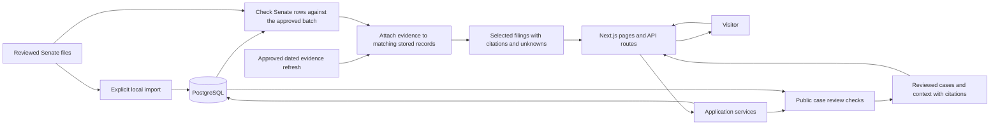

# Bakit Kita Iboboto?

Bakit Kita Iboboto helps Filipino voters browse politician profiles, compare public
records, and read the sources behind them. It includes a chat interface for finding
reviewed Senate filings and separately reviewed cases and context.

This copy includes the application, migrations, and a reviewed starter dataset.
The dataset covers 24 profiles from the Senate's opening roster for the 20th
Congress, dated July 28, 2025, plus 45 selected filings. Current office, career
totals, and enactment remain unverified. The original research database and bulk extracts stay private. The
case tests use synthetic records.
[Senate dataset, sources, and limits](public/data/senate-20/INDEX.md) ·
[Fixture provenance](docs/FIXTURE_REUSE.md) · [Release status](docs/RELEASE_REVIEW.md)

The separate November 22 evidence refresh adds qualified elected terms for all
24 profiles and 41 dated history entries across 31 bills. It preserves the sealed
starter batch, missing values and source conflicts. Scheduled terms do not
establish current office, and dated bill history does not establish current status.
[Refresh coverage and sources](public/data/senate-20-refresh-2026-11-22/INDEX.md)

## What works

| Area                          | Current behavior                                                                                             |
| ----------------------------- | ------------------------------------------------------------------------------------------------------------ |
| Profiles                      | Browse dated Senate membership and selected filings with field citations.                                    |
| Search                        | Use full-text search with Elasticsearch, or the directory's narrower name lookup when search is unavailable. |
| Comparison and saved profiles | Compare profiles and see which records the dataset covers. Guests can save profile IDs in their browser.     |
| Cases and context             | Show only individually approved packets when public case reads are enabled. They start withheld.             |
| Chat                          | Choose a profile and read its reviewed records with citations. This path needs no AI key.                    |
| Languages                     | Choose English, Filipino, or Taglish. Some existing sections and event labels remain English.                |

Type a name in each homepage comparison field and choose a matching profile.
Comparisons start with checked filing titles, dates, and source links. Missing
metrics stay unknown. The homepage shows the first three reviewed bill numbers,
not an impact ranking. Profiles below are alphabetical; edit dates do not certify
verification. No matchup is preselected.

Try `SBN 142` in chat to read a filing and its unresolved date notes. This reader
uses approved fields, checks the loaded database, and makes no model call. Read
the [evidence policy](docs/EVIDENCE_POLICY.md) for sourcing and assessment limits.

The app is a prototype. Production admin access is disabled, new offline profile
downloads are unfinished, and the contact form needs private service configuration.
[Current limits and release status](docs/RELEASE_REVIEW.md)

## How it fits together



The importer loads selected Senate records. Case and context research uses a
separate review process, and case reads start disabled.
[Architecture guide](docs/ARCHITECTURE.md) · [Data guide](docs/DATA.md)

## Run locally

Use Node.js 22.13+ or 24, npm **11.21.2**, and Docker with Compose v2. Use a
fresh local database for this copy.

1. Copy the example settings. Install the locked dependencies and generate the
   Prisma client.

   ```sh
   cp .env.example .env
   npm ci
   npm run db:generate
   ```

   In PowerShell, use `Copy-Item .env.example .env`. To select the required npm
   version in your Node environment, run `npm install --global npm@11.21.2`.

2. Start this copy's PostgreSQL service and apply the migrations.

   ```sh
   docker compose up -d --wait postgres
   npm run db:deploy
   ```

3. Check the import plan, then load the batch into the empty database.

   ```sh
   npm run data:import
   npm run data:import -- --apply
   ```

   The first command checks the bundled files and reports 24 profiles, 45
   filings, and 460 field citations without connecting to a database. The second
   writes the batch in one transaction. An exact repeat returns `unchanged`.
   [Import behavior and refusals](docs/DATA.md#load-the-reviewed-senate-batch)

4. Start the app.

   ```sh
   npm run dev -- --port 3001
   ```

Open [localhost:3001](http://localhost:3001) and browse the Senate profiles.
The example settings keep public case reads, background jobs, and private
contact disabled. Browsing and reviewed-record chat require no provider key.

The Compose project is `bakit-kita-iboboto-refreshed-release`. Its containers
and volumes use names separate from the original and source-only copies.

| Service            | Local address     | Needed for                                        |
| ------------------ | ----------------- | ------------------------------------------------- |
| PostgreSQL 16      | `localhost:55434` | Required database, `bakit_kita_iboboto_refreshed` |
| Redis 7            | `localhost:56381` | Optional development cache                        |
| Elasticsearch 8.17 | `localhost:59202` | Optional full-text search                         |

To start the optional services, run `docker compose up -d --wait redis elasticsearch`.
Set `REDIS_DISABLED=false` when using Redis. Read about index setup before
enabling full-text search. [Configuration](docs/CONFIGURATION.md) ·
[Script catalog](scripts/README.md)

## Check a change

```sh
npm run check
npm run format:check
npm run docs:check
npm run build
npm run data:verify
```

`npm run check` runs lint, typecheck, and Vitest. These contributor commands run
in your working checkout with its local configuration. `npm run data:verify` uses
a disposable PostgreSQL container to check migrations, import, repeat import,
refusals, and rollback.

Before publication, check the prepared source export separately. The
[release-artifact procedure](docs/TESTING.md#verify-a-prepared-release-artifact)
checks pinned tests, dependencies, and file boundaries in a clean extracted copy.
Keep your development `.env` private and outside that export.
[Testing guide](docs/TESTING.md)

## Documentation

[The documentation index](docs/README.md) is the starting point after this README.

| You want to…                                      | Read                                                                        |
| ------------------------------------------------- | --------------------------------------------------------------------------- |
| Understand requests, services, and storage        | [Architecture and data flow](docs/ARCHITECTURE.md)                          |
| Change a feature or find its tests                | [Development guide](docs/DEVELOPMENT.md)                                    |
| Configure services and optional features          | [Configuration](docs/CONFIGURATION.md)                                      |
| Import the approved batch or check what it covers | [Data guide](docs/DATA.md) · [Senate batch](public/data/senate-20/INDEX.md) |
| Review a case or citation                         | [Case and context review](docs/CASE_REVIEW.md)                              |
| Use the research screens and chat                 | [User guide](docs/USER_MANUAL.md)                                           |
| Call the main research endpoints                  | [API reference](docs/API.md)                                                |
| Run an import or maintenance command              | [Script catalog](scripts/README.md)                                         |
| Contribute or report a security issue             | [Contributing](CONTRIBUTING.md) · [Security policy](SECURITY.md)            |

## License and data

Project code uses the MIT license. The approval record specifies CC0 1.0 for the
batch's structured facts and summaries. Linked source documents carry their own
reuse terms. [Code license](LICENSE) · [Third-party notices](THIRD_PARTY_NOTICES.md) ·
[Data terms](public/data/senate-20/INDEX.md#license-and-reuse) ·
[Publication scope](PUBLICATION.md)
