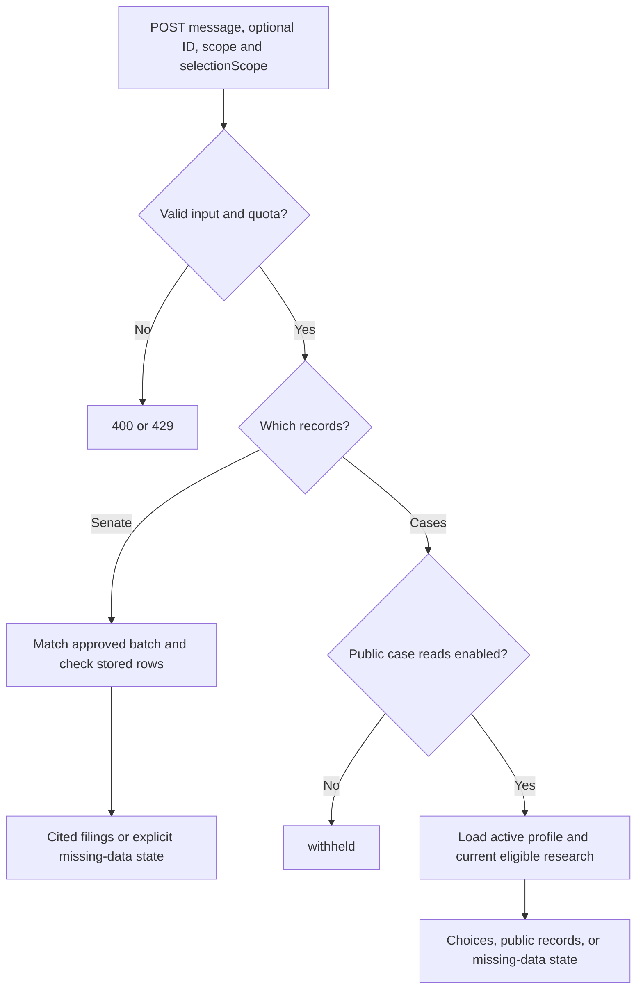

# Research API reference

These are the unversioned routes used by the main research screens. They are not
an exhaustive list of account, admin, or versioned API routes. Paths below use a
profile's stored ID. A fresh database has no sample profile IDs.

The [architecture guide](ARCHITECTURE.md) explains service ownership. Public case
and context fields use the [case-review contract](CASE_REVIEW.md#api-contract).

## Reviewed Senate batch

This populated candidate adds optional `reviewedBatch` context to profiles and bills in the approved batch. It identifies membership observed July 28, 2025, selected filing coverage, exact field citations, and unresolved source differences. `isActive` controls catalog visibility; it does not certify current office.

| Field                                               | Meaning for this batch                                                         |
| --------------------------------------------------- | ------------------------------------------------------------------------------ |
| `currentPosition`                                   | Unknown; dated membership is in `reviewedBatch`                                |
| Bill `filingDate`, `status`, `session`              | Nullable; an unavailable value is not pending or zero                          |
| Bill author role `introduced_by`                    | Original introducer on the filed document, not exclusive or current authorship |
| Source `confidence`                                 | Nullable; no score was estimated for this batch                                |
| Filing `reviewedBatch.integrationApproval`          | Later integration decision, distinct from frozen proposal labels               |
| Scores, eligibility, and missing comparison metrics | Withheld or null when the selected sample cannot establish them                |

The V1 metadata identifies CC0 1.0 for reviewed structured facts, while original documents retain their own rights. Name lookup works directly against the imported PostgreSQL rows, including when an optional Elasticsearch index is empty. See the [dataset guide](../public/data/senate-20/INDEX.md) and [data setup](DATA.md). Existing case endpoints retain their separate review gate.

For comparisons, `reviewedFilings` is an optional map keyed by profile ID. Each
entry has a check `status` and a compact `filings` array with ID, reference, title,
nullable filing date, and source URL. It comes from the same approved-batch reader
as chat. Existing metrics and differences remain in the response; missing metric
inputs stay null. The UI leads with the reviewed records and puts unverified
metrics in a separate section. Counts describe selected records, not performance.

## November 22 evidence context

In this refreshed copy, `reviewedBatch.refresh` is optional. It adds dated
evidence without changing the meaning of the original fields.

| Context | Added fields                                                             | Limits                                                                                                  |
| ------- | ------------------------------------------------------------------------ | ------------------------------------------------------------------------------------------------------- |
| Profile | `electedTerm`, `membershipObservations`, `officeObservations`, `sources` | A scheduled term is not proof of continuous service or current office.                                  |
| Filing  | `events`, `successor`, `sources`                                         | Historical status and a successor law do not establish the original bill's current status or enactment. |
| Both    | `version.datasetId`, `approvedOn`, `scopeUrl`, `approvalUrl`             | Identifies the separate November 22 evidence version, not a new source retrieval.                       |

Public database readers check stored identities before attaching profile evidence.
Bill readers also check the stored title, date, authors and other approved fields;
cached bill details must pass the same checks. Changed or unavailable records
receive no new history. Elasticsearch results omit the new profile evidence
because an indexed identity may be stale. This omission does not mean there is
no evidence in the approved packet.

Sources include document and access dates where established, exact locators,
access methods and independence notes. Indexed-only evidence is identified as
such. See the [refresh scope](../public/data/senate-20-refresh-2026-11-22/INDEX.md).

## Main routes

| Method and path                           | Purpose                                                                             | Implementation                                                       |
| ----------------------------------------- | ----------------------------------------------------------------------------------- | -------------------------------------------------------------------- |
| `GET /api/politicians/{id}`               | Minimal card for a saved profile: ID, name, photo, and current position             | [`route.ts`](../src/app/api/politicians/[id]/route.ts)               |
| `GET /api/politicians/{id}/controversies` | Current public case and context projection                                          | [`route.ts`](../src/app/api/politicians/[id]/controversies/route.ts) |
| `GET /api/politicians/{id}/export`        | Printable HTML export with source attribution; case fields use current public rules | [`route.ts`](../src/app/api/politicians/[id]/export/route.ts)        |
| `GET /api/politicians/search?q=…`         | Small PostgreSQL-backed name lookup                                                 | [`route.ts`](../src/app/api/politicians/search/route.ts)             |
| `GET /api/search?q=…`                     | Elasticsearch-backed full-text results and filters                                  | [`route.ts`](../src/app/api/search/route.ts)                         |
| `GET /api/search/autocomplete?q=…`        | Suggestions, with PostgreSQL fallback when Elasticsearch fails                      | [`route.ts`](../src/app/api/search/autocomplete/route.ts)            |
| `GET /api/compare?ids=…`                  | Compare comma-separated profile IDs                                                 | [`route.ts`](../src/app/api/compare/route.ts)                        |
| `POST /api/chatbot/records`               | Profile choices or reviewed-record answers, without a model call                    | [`route.ts`](../src/app/api/chatbot/records/route.ts)                |
| `GET /api/chatbot/rate-limit`             | Current chat quota for the session or client                                        | [`route.ts`](../src/app/api/chatbot/rate-limit/route.ts)             |
| `POST /api/contact`                       | Configured private reporting through Resend                                         | [`route.ts`](../src/app/api/contact/route.ts)                        |

The directory page has its own name-search fallback. The `/api/search` route does
not itself substitute that directory behavior when Elasticsearch fails. The card
route is not a full-profile or offline-download endpoint. The export route returns
HTML; its query string does not select a server-rendered PDF format.

## Reviewed chat requests

The optional `scope` is `auto` by default. It also accepts `senate_filings` and
`cases`. `message` must contain 1–2000 characters and cannot be blank. An optional
`politicianId` must be a nonblank string of at most 200 characters.

```json
{ "message": "SBN 142", "scope": "senate_filings" }
```

A bill number can return its reviewed filing directly. Names return profile
choices, even for one match. Preserve the original question when sending the
chosen ID, and identify the domain that supplied that choice:

```json
{
  "message": "online gambling bills by Zubiri",
  "politicianId": "selected-profile-id",
  "scope": "auto",
  "selectionScope": "senate_filings"
}
```

`selectionScope` accepts `cases` or `senate_filings`. Automatic routing drops the
selected ID when the question changes domains. Explicit case wording takes the
case path. The scope control can select a reader directly. Unsupported Senate
questions return a coverage state rather than inferred facts.

Senate name and topic matching is literal, not semantic search. It handles one
bill number per request and rejects conflicting or unsupported Congress values.
For case lookup, use a name and `scope: "cases"`. The existing case reader uses
literal substrings of full name, legal name, or nickname and retains its review
gate. A selected-profile case request returns approved records rather than a new
interpretation of an arbitrary question.

The response contains `answer` and `rateLimitStatus`:

| Field in `answer`  | Meaning                                                                  |
| ------------------ | ------------------------------------------------------------------------ |
| `status`           | One of the states below                                                  |
| `profile`          | Selected public ID and name, or null                                     |
| `candidates`       | At most five profile choices                                             |
| `moreProfiles`     | More choices matched; ask for a fuller name                              |
| `records`          | At most ten public case/context records with selected sources and events |
| `remainingRecords` | Number of additional eligible records available on the profile           |
| `checkedAt`        | Server check timestamp; this is a snapshot, not a live subscription      |



Senate responses add `answer.senate`; the existing top-level `records` remains an
empty case-record array. Use `answer.senate.status` for the finer Senate states.
The nested result includes the normalized `query`, `filings`, `remainingFilings`,
and `datasetUrl`. Each filing contains its approved fields, field citations,
source records, date observations, and unresolved conflicts. The outer
`profile`, `candidates`, `moreProfiles`, and `checkedAt` remain available.

| `answer.senate.status` | Meaning                                                            |
| ---------------------- | ------------------------------------------------------------------ |
| `records`              | Loaded rows match the approved batch; cited filings are present    |
| `choose_profile`       | Choose an active matching profile                                  |
| `no_profile`           | No supported profile matches the identity input                    |
| `no_matching_filings`  | No selected filing matches within this batch; not proof none exist |
| `outside_coverage`     | Unsupported question, Congress, or combination of constraints      |
| `not_loaded`           | Required approved records are absent from this installation        |
| `needs_review`         | Stored identity or filing fields differ from the approved record   |
| `unavailable`          | The database check failed                                          |
| `profile_not_found`    | The selected ID is missing, inactive, or outside this batch        |

The following top-level states describe the existing case reader. For Senate
responses, inspect the nested state above instead of inferring a case result.

| `answer.status`       | What the reader can conclude                                                   |
| --------------------- | ------------------------------------------------------------------------------ |
| `choose_profile`      | A profile choice is needed; no case answer has been selected                   |
| `no_profile`          | The name input did not match an active profile                                 |
| `records`             | The response contains eligible records for the selected profile                |
| `no_reviewed_records` | No eligible records are available; this does not establish that no cases exist |
| `withheld`            | Public case reads are disabled                                                 |
| `unavailable`         | The service could not check the research state                                 |
| `profile_not_found`   | The selected profile is missing or inactive                                    |

These answer states use HTTP 200, including research unavailability handled by
the record service. Malformed input uses 400, exhausted quota uses 429, and an
unexpected request-layer failure uses 503. All responses set `Cache-Control: no-store`.
The route creates no conversation messages and retains no query text in its
rate-limit history. The current chat counters are local to each server process.

## Other response boundaries

The card route returns 404 for a missing profile and 503 for a database failure.
It uses `private, no-store`. Its response excludes research and source payloads.
The case route's version 2 response has explicit `available`, `withheld`, and
`unavailable` states; consult its [full contract](CASE_REVIEW.md#api-contract).

`POST /api/chatbot` and its history methods remain separate general-AI APIs. They
retain provider and conversation behavior and are not called by the dock. An
absent provider key returns 503 from that older POST route.

Private contact has origin checks, body limits, a shared Redis budget, and provider
failure handling. HTTP 202 means Resend accepted a message; it does not prove inbox
delivery. Use the [contact guide](PRIVATE_CONTACT.md) for that contract.
