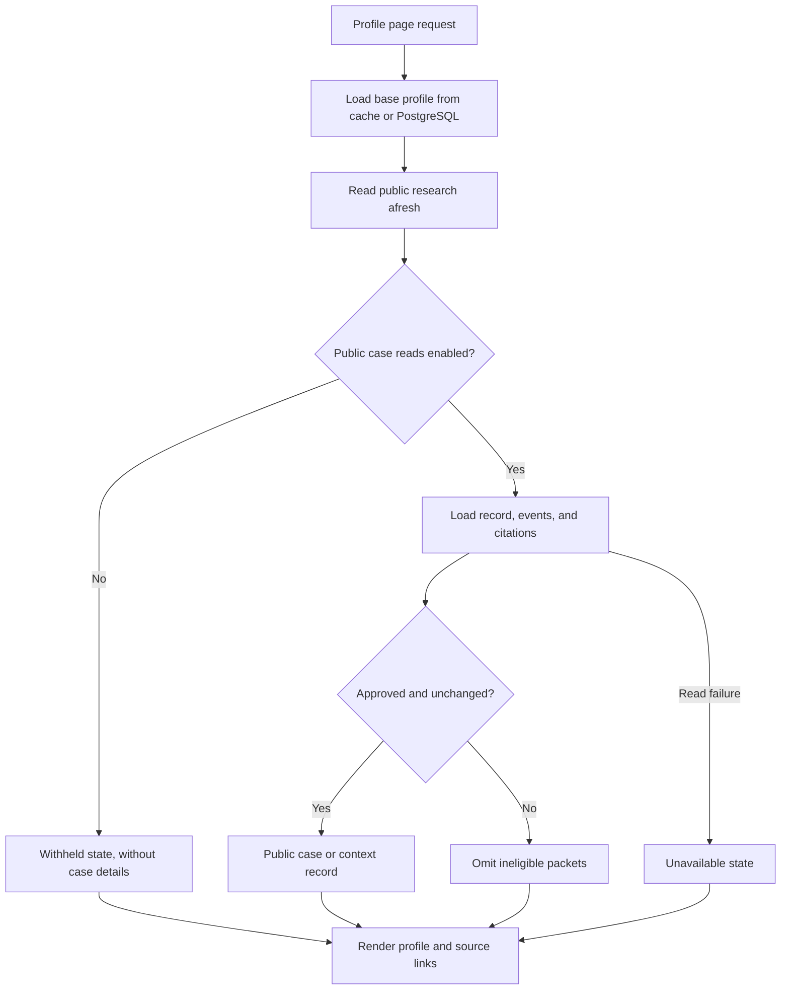
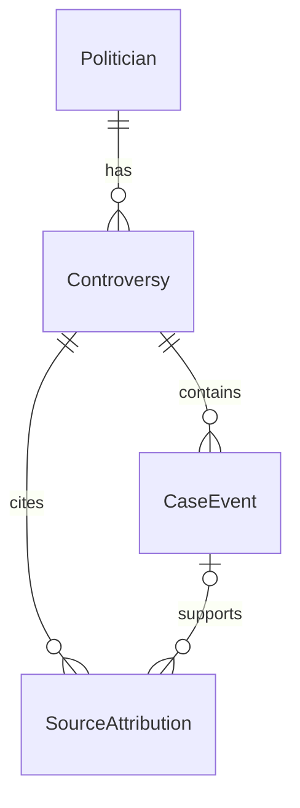
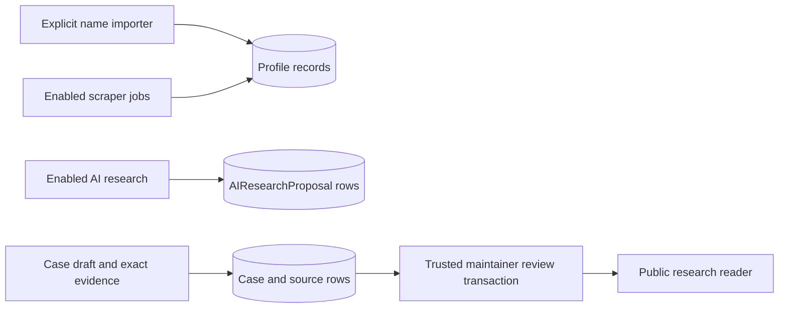
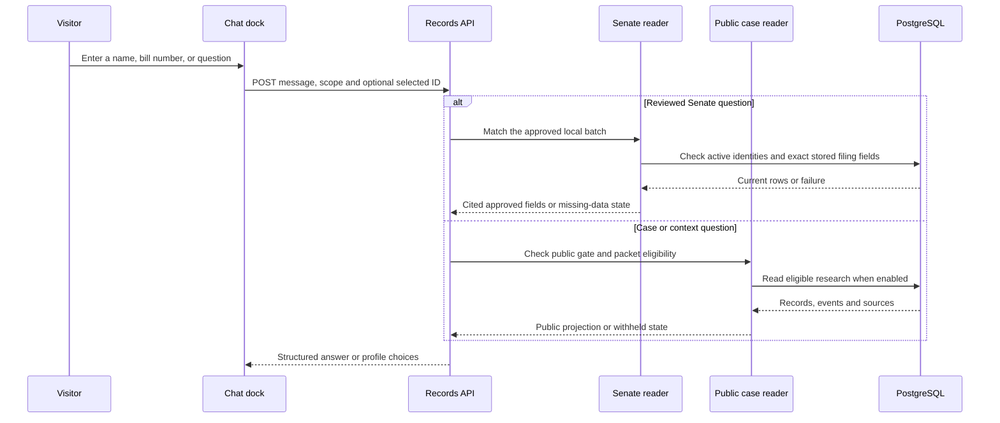

# Architecture and data flow

The application runs in Next.js. Pages and route handlers call services under
`src/services/`. PostgreSQL stores records through Prisma 7 and its PostgreSQL
adapter. Redis supports caches and production sessions; Elasticsearch provides
optional full-text search.

A new installation contains schema and migrations, with an empty database. Use
[local setup](../README.md#run-locally) first, then read the [data guide](DATA.md)
before adding records.

## Main components

| Component              | Responsibility                                                                     | Source                                                                                 |
| ---------------------- | ---------------------------------------------------------------------------------- | -------------------------------------------------------------------------------------- |
| Pages and API routes   | Render screens and validate HTTP requests                                          | [`src/app`](../src/app)                                                                |
| Domain services        | Load profiles, comparisons, finances, research, and related records                | [`src/services`](../src/services)                                                      |
| Database client        | Share one runtime client and validate connection options                           | [`prisma.ts`](../src/lib/prisma.ts), [`prisma-client.ts`](../src/lib/prisma-client.ts) |
| Database schema        | Define models, relationships, and review metadata                                  | [`schema.prisma`](../prisma/schema.prisma)                                             |
| Public research reader | Project eligible cases and context without private review metadata                 | [`public-research.service.ts`](../src/services/public-research.service.ts)             |
| Case rules             | Validate packets, preserve date precision, and check fingerprints                  | [`case-review.ts`](../src/lib/case-review.ts)                                          |
| Search                 | Read the installation's Elasticsearch index and recalculate public case indicators | [`search.ts`](../src/lib/search.ts)                                                    |
| Offline storage        | Save permitted profile fields and withhold case details offline                    | [`offline-storage.ts`](../src/lib/offline-storage.ts), [`sw.js`](../public/sw.js)      |

## Read a profile

The same public research rules supply case indicators, filters, exports, and
reviewed chat. Cached biography data does not establish current case eligibility.
List and search readers apply eligible IDs before pagination. Stored legacy
legal flags do not supply current case labels.

The flag and packet review are separate checks. Turning on a flag does not
approve stored records. An available empty result also differs from withheld or
unavailable research. See [case review](CASE_REVIEW.md) and the [API reference](API.md).

## Case data model

This diagram shows citations owned by a case packet. `SourceAttribution` also
supports other profile fields outside this subset.

`Controversy` is the schema name for case and context research. It does not mean
that every row is a finding against the person. The classification and subject's
role determine whether a public record belongs under cases or context.

A review packet includes the parent, all events, and attached sources. Its content
fingerprint detects later edits. Reviewer identities, private notes, old status
fields, and the fingerprint stay out of the public response. A conviction and
later relief remain separate fields.

## Data enters through different paths

The name importer writes names directly to the configured development database.
Some background scrapers also write non-case records directly. Several legacy
fetch functions return empty arrays. The scheduler is not a complete production
data feed and does not put every profile field through case review.

AI research stages proposals for human review. It does not automatically publish
profile fields. `src/instrumentation.ts` starts the scheduler only when
`DATA_PIPELINE_ENABLED=true`; AI research has its own flag. Both start disabled.
Job state is held in process memory. [Configuration](CONFIGURATION.md) lists the
flags, and [data setup](DATA.md) explains their limits.

## Reviewed chat

`senate-chat.service.ts` matches approved data from `release-data.ts` and checks
stored rows before returning that data. It does not trust an edited database row
as new evidence. `reviewed-chat.service.ts` retains the separate case gate and
public research reader. The route clears selected IDs on automatic domain changes.

This route makes no model call and stores no conversation. The dock clears old
answers when closed, hidden, disconnected, or moved to another route. A visible
answer remains a snapshot at its displayed check time. The separate general-AI
API retains its own provider and conversation behavior. The dock does not use it.
See [the workspace guide](CIVIC_WORKSPACE.md#reviewed-records-in-chat) and
[evidence policy](EVIDENCE_POLICY.md).

## Browser storage and private contact

Guest saved profiles use browser storage. Offline views show biography fields,
with unknown case and indicator counts. The service worker removes generated
case-bearing responses and respects `no-store`; a disconnect invalidates the
current case display. The new-profile download route remains unfinished.

Private reports take a separate path through `/api/contact`, a Redis send budget,
and Resend. They do not become profile records or community reports automatically.
The [contact guide](PRIVATE_CONTACT.md) documents that flow.

For changes to any of these paths, use the [development map](DEVELOPMENT.md) and
[focused tests](TESTING.md).
