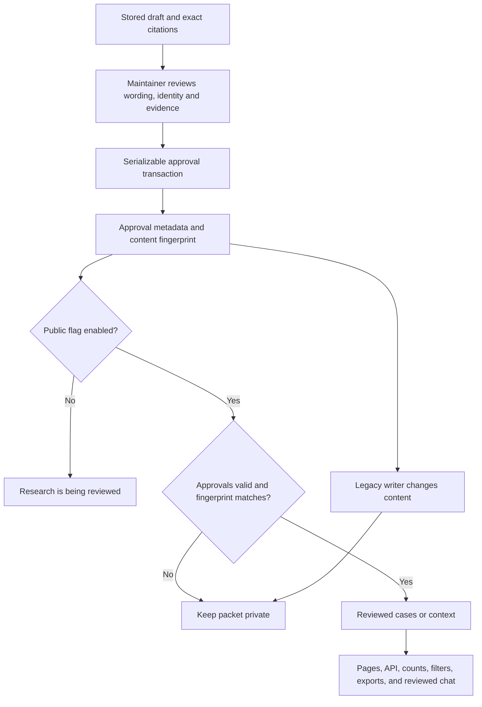

# Case and context review

Case and context displays start withheld. Public reads require
`PUBLIC_CASE_RECORDS_ENABLED=true` and an individually approved, unchanged packet.
Old records and citations remain stored; the migration approves none of them.
The [data guide](DATA.md) explains how records enter the installation.

This workflow does not establish source truth or redistribution rights. The
[synthetic regression fixtures](FIXTURE_REUSE.md)
are test inputs, not approved public data. It also leaves
non-case dynasty, SALN, and attendance indicators under their existing rules.

## What a review covers

A packet contains one `Controversy`, all its `CaseEvent` rows, and all citations
attached to the parent or its events. A maintainer checks identity, classification,
wording, jurisdiction, outcome, any relief, and the passages supporting them.



Keep criminal, civil, administrative, and context records distinct. Claimants,
misinformation targets, relatives, and commentators do not receive a personal case
flag. A pardon is a separate event beside the conviction; it is not an acquittal.
Only the reviewer-selected judgment, appeal, or dated status report supplies an
outcome. Enforcement events cannot replace it.

Dates retain their precision: `2016`, `2016-11`, `2016-11-18`, or null. Partial dates
do not gain an invented day or establish a precise timeline order. Approval or
import timestamps must not substitute for event dates. The homepage does not rank
profiles by reviewed case activity.

## Approve a draft

This is a trusted maintainer operation, with no HTTP approval endpoint or automatic
import approval. First test on an authorized development copy. Applying the schema
or approving records in an existing database needs separate authorization.

1. Assemble the parent, owned events, and exact citations. Keep unknown legacy
   status null. Select the outcome and any applicable relief explicitly.
2. Select at least two citations, including two independent document URLs. Each
   event needs an owned selected citation. Record supporting passages in
   `evidenceLocator` and explain independence and uncertainty in `reviewNote`.
3. Load the complete draft and calculate `caseContentHash(packet)` from
   `src/lib/case-review.ts`.
4. Call `approveCaseReview` from `src/services/case-review.service.ts` with the
   record ID, that expected hash, reviewer, review time, note, selected citation
   IDs, and the two independent citation IDs.
5. A changed draft raises `CaseReviewConflictError`; reload and review it again.
   Invalid content raises `CaseReviewValidationError` with issue codes. Approval
   writes event, selected citation, and parent metadata in one transaction.

The fingerprint detects content changes. It does not authenticate a reviewer or
prove that two sources are independent. An unchanged packet still needs approved
metadata on its parent, events, and selected citations. Unselected old citations
remain stored and hashed but do not appear publicly.

## API contract

`GET /api/politicians/{id}/controversies` returns the version 2 contract below.
Consumers must read the envelope rather than expect an array. The
[API reference](API.md) also covers reviewed chat and profile summaries.

| State                          | HTTP | Body                                                                                      |
| ------------------------------ | ---- | ----------------------------------------------------------------------------------------- |
| Available                      | 200  | `{schemaVersion: 2, availability: "available", records: [...], totals: {cases, context}}` |
| Withheld                       | 200  | `{schemaVersion: 2, availability: "withheld", records: [], totals: null}`                 |
| Database failure while enabled | 503  | `{schemaVersion: 2, availability: "unavailable", records: [], totals: null}`              |

Records have `section: "case"` or `section: "context"`, reviewed wording,
classification, selected citations, and a sourced event timeline. Case records add
a reviewed outcome and applicable relief. Reviewer identities, private notes,
fingerprints, and legacy status are excluded. Types live in `src/lib/case-review.ts`.
Responses use `private, no-store`.

An available empty result means “No reviewed records are available.” A withheld
result means “Research is being reviewed.” Neither proves that no case existed.
Shown indicator totals exclude withheld case signals. Failed eligibility checks
raise an error; list filters do not guess.

## Caches, offline views, and rollback

Public readers recalculate eligibility after base-profile cache hits and before
list pagination. Stored legal/corruption flags and flags linked to a controversy
are ignored; approved packets supply fresh case flags. Generic profile sources
exclude case citations.

The service worker expires generated case-bearing HTML and API cache entries. It
refuses manual profile-response caching. Saved IndexedDB profiles and queued user
actions remain intact. Offline screens show a biography-only projection with
unknown case/flag counts and “Case details require an online review check.” New
saves also use that projection. A disconnect hides case details and counts on an
already-open profile too. Reload after reconnecting to obtain a fresh review check.

The existing new-profile download URL is still unimplemented. There is no
public mirror of the API-key-protected versioned endpoint. Verification uses
an existing synthetic saved profile.

To roll back public case visibility, run this tested application with
`PUBLIC_CASE_RECORDS_ENABLED=false`. Keep the additive schema and evidence rows.
Do not redeploy a pre-gate build: it can expose old labels again. There is no
automatic destructive down migration.

## Verify safely

Use Node 22 and npm 11.21.2. After generation, checks, and a production build, run:

```sh
npx --no-install tsx scripts/verify-case-review.ts
```

The verifier requires Docker and the installed Puppeteer browser. It accepts no
external database URL. It owns a labeled PostgreSQL 16 container on a random
loopback port, applies old and new migrations in an ignored temporary directory,
and uses synthetic records only. Cleanup removes that container and directory.
It tests ownership constraints, retained legacy data, transaction rollback, stale
approval, legacy edits, production HTTP responses, reviewed chat, offline browser
behavior, and default-off rollback with the event table unavailable. Missing
prerequisites or a failed check fail the command. The [testing guide](TESTING.md)
explains the unit/integration boundary. CI runs the verifier after its build.

This workflow requires review work and uncached fingerprint checks. Imports can remain private
for longer, and offline case browsing is unavailable. Those limits keep an old
status or cached label from publishing an unsupported allegation.
