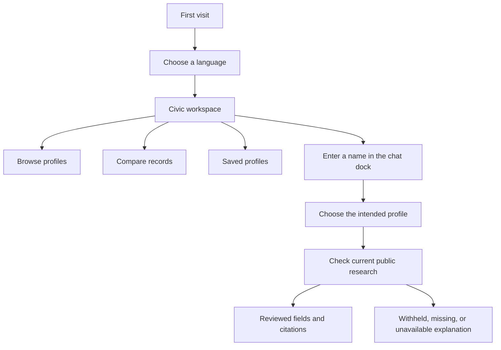
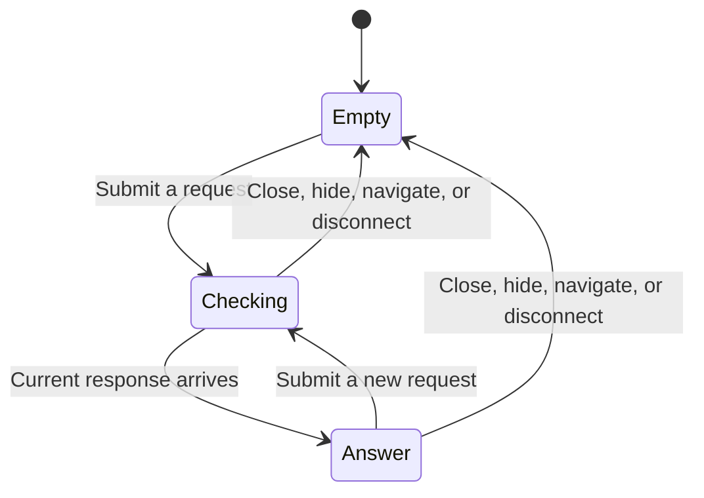

# Civic workspace and reviewed chat

The homepage offers profile browsing, comparison, and saved profiles. A bottom
composer opens a conversation panel after submission. On phones, the panel fills
the screen. The same input stays mounted during the transition; reduced motion
disables the movement.

A first-visit dialog offers English, Filipino, and Taglish. The choice uses the
`NEXT_LOCALE` cookie and needs no account. Visitors can change it from the header.
Some profile sections, approved wording, and event labels remain English.

## Visitor flow

Case questions check the public case gate before name lookup. Senate filing
questions use a separate approved-batch reader and remain usable while case
research is withheld. A scope control lets the visitor choose which records to search.

## Read the labels correctly

| Label or state                                           | Meaning                                                                        |
| -------------------------------------------------------- | ------------------------------------------------------------------------------ |
| Active profile count                                     | Profiles in this installation, not an official candidate or ballot count       |
| Profile updated date                                     | The profile row changed; it does not mean every field was verified             |
| N/A for attendance, bill passage, or promise fulfillment | The underlying records needed for a rate are absent                            |
| Zero attendance                                          | A zero rate can be shown when actual session records support it                |
| Empty family network                                     | No relationships are available here; this does not establish that none exist   |
| Limited conflict findings                                | Results depend on the records checked; they are not a clean-record declaration |
| No reviewed records                                      | No eligible research is available; this does not establish that no case exists |
| Withheld research                                        | Public case reads are disabled                                                 |
| Unavailable research                                     | The service could not check the current research state                         |

The directory falls back to narrower name matching when full-text search is
unavailable. It explains that scope and retains office and location filters.
A database outage is separate from an empty result. Guest saved profiles use
browser storage; a failed lookup does not erase the saved IDs.

## Reviewed records in chat

Use one bill number, a short title, or a person's name. Senate name matches ask
for a profile choice, even when one matches. Ambiguous surnames require a choice.
A bill number can identify a filing directly. Title and topic matching uses
literal words, so an empty match is not an exhaustive research finding.

The dock uses `POST /api/chatbot/records`, without a provider key or model call.
Automatic mode routes recognizable filing queries to the Senate reader. Explicit
case questions retain the case gate. Changing record domains clears the previous
profile context so a Senate choice cannot silently select a person for cases.

| Reader            | Supported answer                                                                                  | Limits                                                                                                    |
| ----------------- | ------------------------------------------------------------------------------------------------- | --------------------------------------------------------------------------------------------------------- |
| Senate filings    | Approved title, summary, original introducer, supported date, field citations, and date conflicts | Selected 20th Congress batch only. Status, enactment, social impact, and career totals remain unverified. |
| Cases and context | Approved wording, outcome, later relief, context, and dated event citations                       | Separately approved packets only. Default-off public case gate still applies.                             |

The Senate service compares loaded database rows with the approved batch on each
request. It distinguishes no match, an unloaded batch, changed rows needing
review, and unavailable storage. At most ten filings are returned; the answer
states how many matching filings remain. The case reader retains its five-choice
and ten-record limits.

Answers are snapshots at the displayed check time. This route stores no
conversation messages or query text in rate-limit history. Existing session and
client counters are held per server process. See the
[API reference](API.md#reviewed-chat-requests) and [evidence policy](EVIDENCE_POLICY.md).

## When an answer is cleared

Only the latest answer remains in the tab. Closing the dock, changing routes,
hiding the tab, or disconnecting clears it and cancels pending requests. A
cancelled draft remains available. Reopen and send again for a fresh check.
Profile links close the mobile panel and release the page behind it.

The separate general-AI endpoint, `POST /api/chatbot`, retains its provider and
conversation behavior for existing callers. The dock never calls or falls back to
it. Hosting that endpoint requires its own operational and editorial decisions.

Public case reads remain off by default. Read the [user guide](USER_MANUAL.md) for
the browsing workflow and [release status](RELEASE_REVIEW.md) before hosting.
