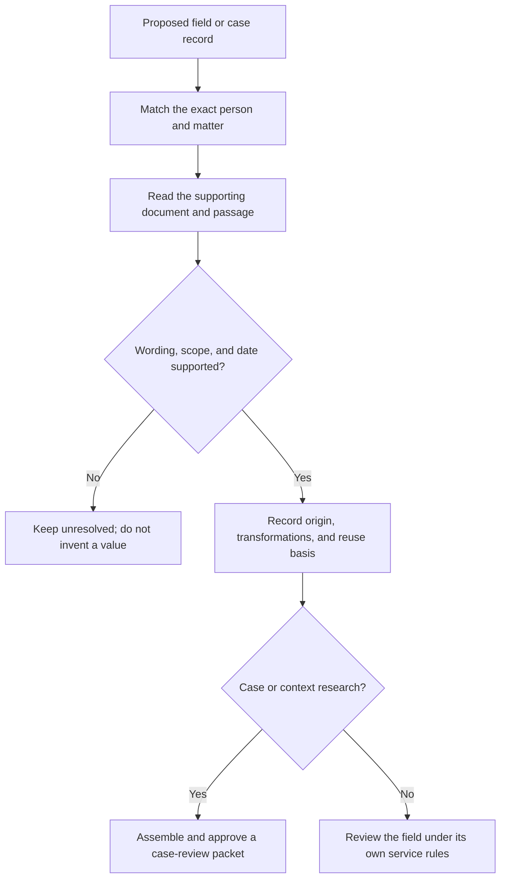

# Supply data for a local installation

The populated copy includes a reviewed Senate dataset. A fresh database begins
empty. Run the explicit import after applying migrations to the separate local
PostgreSQL database. [Local setup](../README.md#run-locally)

## Load the reviewed Senate batch

| Evidence         | Included                                                                                | Scope                                                                                                       |
| ---------------- | --------------------------------------------------------------------------------------- | ----------------------------------------------------------------------------------------------------------- |
| Dated membership | 24 profiles from the Senate's opening roster for the 20th Congress, dated July 28, 2025 | Current office and term dates are unknown                                                                   |
| Selected filings | 45 bill references, titles, summaries, and introducers credited on the filed documents  | Career totals, current legislative status, and enactment are unknown                                        |
| Filing dates     | 44 dates from Senate filing records                                                     | The conflicting filing-date observations for SBN-142 remain visible. The normalized filing date is unknown. |
| Field citations  | 460 database citations linked to profile and bill fields                                | The source manifest records publishers, evidence locators, retrieval methods, and relationships             |
| Held filings     | SBN-102, SBN-141, and SBN-179 are listed in the coverage record                         | These records are outside the import                                                                        |

Bill details keep original introducers distinct from additional names in Senate
indexes. The roles and addition dates for those names remain unknown. The batch
also leaves election history, party affiliation, attendance, voting, financial
disclosures, family relationships, and case claims outside its coverage. Unknown
fields cannot support a score or a finding about performance.
[Dataset and review notes](../public/data/senate-20/INDEX.md)

Use the empty database named `bakit_kita_iboboto_populated` after applying the
migrations. The dry run checks the approved source bytes and displays the import
counts without connecting to PostgreSQL.

```sh
npm run data:import
npm run data:import -- --apply
```

The apply command writes the batch in one transaction. It returns `unchanged` if
the database already holds exactly the imported batch. Existing unrelated rows
or changed batch values cause the command to refuse the import before any write.
An exact repeat leaves the database as it is. A failed write rolls back the whole
batch. Applying this batch to an existing installation requires a separate
decision and migration plan.

Run `npm run data:verify` to exercise the migrations, first import, exact repeat,
refusal, drift detection, and rollback. The verifier starts and removes its own
disposable PostgreSQL container. It uses that database even if `DATABASE_URL` is
already set. [Script catalog](../scripts/README.md)

## Other data paths

| Path                         | What it writes                                                | Scope                                                                                            |
| ---------------------------- | ------------------------------------------------------------- | ------------------------------------------------------------------------------------------------ |
| `npm run scrape:politicians` | Names from BetterGov into the configured development database | Name lookup only. Profile facts need field-level sources.                                        |
| Authorized database transfer | The records selected by the operator                          | Requires its own source, privacy, and reuse review. [Transfer guide](../DATA-MIGRATION-GUIDE.md) |
| Enabled scheduler            | Records handled by the selected scraper                       | Some fetch functions return empty arrays. Other jobs write non-case records directly.            |
| Enabled AI research          | Findings and citations in `AIResearchProposal`                | A reviewer must assess each proposal before use.                                                 |
| Trusted case approval        | Review metadata for an existing complete packet               | Source truth, reviewer identity, and redistribution rights require separate checks.              |

Use a separate development database for these paths. For a small synthetic case
packet, see [the test fixture](../src/test/fixtures/case-review.ts).

## Record evidence before publishing a claim



This is the review procedure for supplied data. It is not a claim that every
legacy import path enforces these steps automatically. The
[architecture guide](ARCHITECTURE.md#data-enters-through-different-paths) distinguishes
those paths.

| Record with a source                 | Why it matters                                                    |
| ------------------------------------ | ----------------------------------------------------------------- |
| Exact document URL and title         | A domain or search result alone does not identify evidence        |
| Supporting passage or field          | Shows what the document actually supports                         |
| Document, event, and retrieval dates | These dates describe different things; keep unknown dates unknown |
| Person and proceeding identifiers    | Prevents mixing people, cases, or relatives' proceedings          |
| Original value and transformation    | Makes normalization or summarization reviewable                   |
| Reuse basis and restrictions         | Source access alone does not establish redistribution permission  |

A publication date is not a filing date. A relative's proceeding does not establish
the subject's outcome. Source type, numeric confidence, and a reachable URL do not
prove truth or independence.

## Verify third-party datasets

BetterGov is a possible discovery source for election history and surname blocs.
Its [API documentation](https://github.com/bettergovph/officials-network-graph/blob/main/docs/api.md)
describes source citations, data vintage, matching confidence, and coverage. It
also warns that shared surnames do not prove kinship. This guide does not approve
an import or claim that the current application implements that API.

Review an imported claim against the documents behind it before publishing it:

| Proposed claim                 | Evidence to retain                                                                                                                         |
| ------------------------------ | ------------------------------------------------------------------------------------------------------------------------------------------ |
| Election result or office held | The exact election, jurisdiction, candidate identity, and official result or office record supporting the value.                           |
| Family relationship            | A document that directly establishes the specific relationship. A shared surname, matching model, or surname bloc is insufficient.         |
| Dynasty indicator              | The definition, election period, geography, underlying records, and method. Keep inferred surname grouping distinct from verified kinship. |
| Case or outcome                | The exact person, proceeding, judgment or dated status document, and supporting passage. Follow the separate case-review workflow.         |

Keep the upstream record identifier, dataset version, retrieval date, original
value, transformation, exact citations, reviewer, and review date. Inspect each
dataset's reuse terms separately from its project's code license. Read coverage
and matching limits before joining people across sources.

Seek independent corroboration where the claim needs it. Two sites copying the
same underlying dataset are one evidence chain. Leave unsupported relationships
unconfirmed and missing values unknown. A populated field or provider label is
not evidence of verification. These are review requirements; legacy importers do
not automatically enforce them.

## Case and context data

Follow [case review](CASE_REVIEW.md) for criminal, civil, administrative, and context
records. Keep the public-case flag false until the installation is ready for
public research reads. Even with the flag enabled, each packet must be approved
and still match its content fingerprint.

The [API](API.md) and [chat interface](CIVIC_WORKSPACE.md#reviewed-records-in-chat)
use that public projection. A record withheld by the reader must not reappear
through a cached count, search result, export, or assistant answer.

## Background work

`DATA_PIPELINE_ENABLED` and `AI_RESEARCH_ENABLED` both start false. Research also
needs a provider key and can incur provider charges. Review the
[configuration reference](CONFIGURATION.md#optional-features) before enabling them.
The scheduler stores its job state in memory; it is not a durable job queue.

Keep backups, account data, messages, reports, and private voting lists outside
source control. Check the approval and reuse terms before adding data.
[Publication scope](../PUBLICATION.md) · [Senate batch license and reuse](../public/data/senate-20/INDEX.md#license-and-reuse)

## Evidence before expansion

Use the [evidence policy](EVIDENCE_POLICY.md) when proposing more records.
BetterGov is useful for discovery and structured data; verify each proposed
field against its exact primary evidence and identify shared origins. A successful
import validates the approved packet, not a new factual claim. Keep disputed
fields unknown until a reviewed correction resolves the difference.
