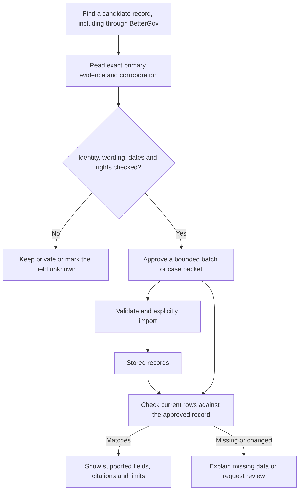

# Evidence and missing data

A profile statement needs evidence for that exact statement. A citation count
cannot establish that the statement is true. A bill's title can support its
identity, but cannot establish its social effects or whether it became law.

## Source requirements

We use the [IFCN application guidelines](https://www.ifcncodeofprinciples.poynter.org/application-guidelines.pdf)
as a sourcing reference, not a claim of IFCN certification. They call for
corroborating central claims with multiple sources, with an exception when only
one relevant source exists. They also favor primary sources and reproducible
citations. This project applies that approach by claim type.

| Statement                                          | Evidence needed before approval                                                                                                                                  |
| -------------------------------------------------- | ---------------------------------------------------------------------------------------------------------------------------------------------------------------- |
| Official filing number, title, or named introducer | Exact filed document and a separate official record where available. Document a single-authority exception when no other relevant record exists.                 |
| Current legislative status or enactment            | Current official history and the relevant legislative or enacted instrument. A proposal, press release, or old filing cannot substitute.                         |
| Contested allegation or case outcome               | Exact proceedings, identity, procedural stage, dates, later decisions, and independent corroboration where available. Use the separate case-review requirements. |
| Possible social effect                             | Identified bill version, affected groups, baseline, assumptions, and independent evidence relevant to each effect. Label forecasts as estimates or hypotheses.   |
| Observed social outcome                            | Post-implementation evidence with a stated period, method, limitations, and alternative explanations. A predicted effect is insufficient.                        |

Count independent evidence origins, not URLs. BetterGov can help discover and
structure records, but its copy of a Senate record is not independent confirmation
of that same record. Multiple reports repeating one press release also share one
origin. More links cannot resolve contradictory dates. Keep the conflict visible
and leave the disputed field unknown until the discrepancy is explained.

For each approved field, retain the exact source URL, document identity, supporting
page or passage, document date, retrieval date, and derivation. Record reuse terms,
review responsibility, unresolved differences, and the date to recheck a claim.
Source selection and meaning require human review. A familiar domain or an AI
answer cannot approve a claim.

## What the software checks

The Senate reader accepts only the sealed batch. It checks loaded identities,
filing fields, and introducer relationships before returning approved wording and
citations. Missing rows, changed records, and database failures have distinct
responses. It rejects unsupported Congresses and does not invent a status, date,
career total, or impact rating. The case reader has its own default-off gate and
packet eligibility checks. Neither reader sends records to a model.

These checks prevent some unsupported writes and displays. They do not prove that
a reviewer understood a document correctly or that a cited website remains
available. Corrections require a new reviewed proposal; changing a database row
alone does not approve new evidence.

## Impact assessment limits

There is no public impact ranking in this candidate. The homepage's three filing
examples follow bill-number order. A private three-bill AI pilot separates exact
approved facts from conditional hypotheses. Those drafts are unreviewed and are
excluded from the release tree. A model's structured JSON format verifies shape,
not truth.

Before adding an impact level, define the comparison baseline, affected groups,
likely benefits and costs, distribution, implementation conditions, time horizon,
and uncertainty. This follows established
[OECD impact-assessment practice](https://www.oecd.org/content/dam/oecd/en/publications/reports/2025/10/applying-regulatory-impact-assessment-at-regulatory-authorities_18a99d8f/0b5ea522-en.pdf).
A future scoring rubric also needs published thresholds and a consistent way to
compare proposals. Keep evidence quality separate from estimated impact. Human
approval is required before any new assessment or ranking appears in the app.

Read the [dataset notes](../public/data/senate-20/INDEX.md),
[case-review contract](CASE_REVIEW.md), and [data workflow](DATA.md) for the
existing approval paths. Report an exact wording or citation problem through the
installation's correction route. Private delivery must be configured and verified
before a maintainer relies on the contact form.
