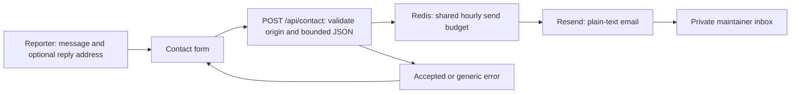

# Private contact with Resend

When configured, the `/contact` page accepts corrections, privacy requests,
security reports, and questions. The maintainer chose Resend and a private receiving inbox. The inbox
address is recorded outside this source copy. No Resend SDK or other dependency
was added.

Reports never become profile records automatically. This route writes no message
to the application database. The existing community moderation forms are separate.

## Configure privately

1. Create or select a Resend account. Verify a sending domain or subdomain using
   [Resend's domain setup](https://resend.com/docs/dashboard/domains/introduction).
   Add the required sending records; preserve the receiving inbox's existing MX
   records. Do not move receiving mail to Resend just to send reports.
2. Create an API key with the sending access needed for that domain. Store it in
   server secrets. Do not paste it into an issue, browser setting, or source file.
3. Supply these server-only settings using the empty keys in `.env.example`:

   | Setting                   | Value                                                                                 |
   | ------------------------- | ------------------------------------------------------------------------------------- |
   | `PRIVATE_CONTACT_ENABLED` | `true`, after the checks below                                                        |
   | `PRIVATE_CONTACT_ORIGIN`  | Exact public HTTPS origin, without a trailing slash; loopback HTTP is allowed locally |
   | `PRIVATE_CONTACT_FROM`    | Sender on the verified Resend domain, optionally with the project display name        |
   | `PRIVATE_CONTACT_TO`      | The maintainer's private receiving address                                            |
   | `RESEND_API_KEY`          | The private sending key                                                               |
   | `REDIS_URL`               | This installation's working, protected Redis service                                  |
   | `REDIS_DISABLED`          | `false`                                                                               |

4. On the intended deployment, send a harmless test through the form. Confirm its
   arrival in the intended inbox and reply behavior when a reply address is
   supplied. Check spam and Resend delivery status. Record that operational check
   privately before presenting this as a working reporting route.

None of the contact settings uses `NEXT_PUBLIC_`. The page passes only a boolean
to the browser. Missing configuration disables the controls and returns HTTP 503
from the API. Configured availability is not proof that Redis or mail delivery
is currently working.

## Request and delivery limits

- The route accepts JSON from the configured origin, with a maximum 16 KiB body
  and a five-second read deadline. It validates the category, message, optional
  URL, optional reply email, and retry UUID. URLs are not fetched; attachments are
  not accepted.
- A Redis counter reserves up to 20 validated attempts per clock hour across
  instances. It stores a count, not message contents or reporter IPs. A Redis
  failure or three-second reservation deadline stops the send. A delayed Redis
  command can still consume a count after the request stops waiting.
- The sender, receiver, subject prefix, and provider endpoint are server-controlled.
  Reports are plain text. An optional reporter address sets only `reply_to`.
- Provider requests have a five-second timeout. HTTP 202 means Resend accepted
  the message with a receipt ID; it does not prove inbox arrival. An unchanged
  retry reuses its UUID for Resend's
  [24-hour idempotency window](https://resend.com/docs/dashboard/emails/idempotency-keys).
- Application logs contain generic failures and provider status codes, without
  report text, addresses, keys, provider error bodies, or request payloads.

The global budget is deliberately simple. Someone can exhaust it and prevent
other reports for the hour. Configure ingress abuse protection and monitoring
before hosting. Origin validation is a browser check, not bot authentication.

## Privacy and release limits

The form discloses that Resend processes the submitted details. A reply email is
optional. The application does not save reports, but mail providers, the receiving
inbox, and hosting infrastructure can retain copies or request metadata under
their settings. The operator must establish access, retention, deletion, and
privacy-notice arrangements before public use.

A form can hide the inbox address. It does not guarantee reporter anonymity or
replace required operator identity and contact information. The operator and hosted-service review decisions remain separate; see
[release status](RELEASE_REVIEW.md).

The API tests cover validation, limits, Redis and provider failure paths, retry
keys, fixed addressing, and response privacy. Local browser checks use controlled
API responses. A local synthetic delivery attempt reached the provider but was rejected.
No successful send or inbox receipt is claimed. Sender-domain setup is deferred;
the form stays disabled. Production abuse controls and hosted operation remain
unverified. Source-only publication uses the repository security-reporting process
in [SECURITY.md](../SECURITY.md); it does not require this Resend integration.

The implementation follows the official
[send-email API](https://resend.com/docs/api-reference/emails/send-email).

Use the [configuration reference](CONFIGURATION.md#private-contact) for the setting map
and the [API reference](API.md#other-response-boundaries) for the route boundary.
