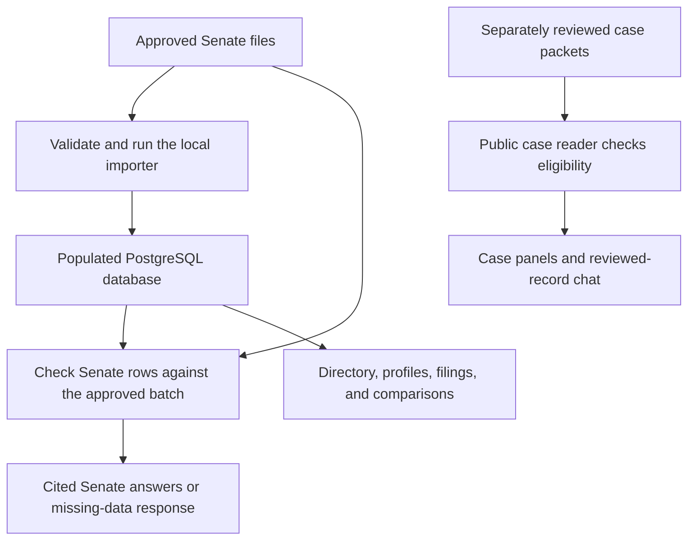

# Documentation

Start with the [project README](../README.md) to run a local installation. Use this
index to find the guide for the job you are doing.

## Find a guide

| Task                                    | Guide                                             | What it covers                                                             |
| --------------------------------------- | ------------------------------------------------- | -------------------------------------------------------------------------- |
| Understand the system                   | [Architecture](ARCHITECTURE.md)                   | Request flow, database ownership, review checks, caches, and offline data  |
| Change application code                 | [Development](DEVELOPMENT.md)                     | Source map, change checklist, and common setup problems                    |
| Configure an installation               | [Configuration](CONFIGURATION.md)                 | Services, environment variables, default-off features, and hosting limits  |
| Test a change                           | [Testing](TESTING.md)                             | Focused commands, full checks, and disposable database verification        |
| Import the reviewed Senate batch        | [Data](DATA.md#load-the-reviewed-senate-batch)    | Dry run, apply, repeat import, and disposable database verification        |
| Check a roster entry or filing citation | [Senate batch](../public/data/senate-20/INDEX.md) | Dated membership, selected filings, evidence, and approval                 |
| Review source support                   | [Evidence policy](EVIDENCE_POLICY.md)             | Corroboration, independent origins, unknowns, and impact-assessment limits |
| Approve case research                   | [Case review](CASE_REVIEW.md)                     | Review packets, outcomes, citations, fingerprints, and rollback            |
| Call a research endpoint                | [API](API.md)                                     | Profile summaries, case responses, reviewed chat, and failure states       |
| Understand the homepage and chat        | [Civic workspace](CIVIC_WORKSPACE.md)             | Language choice, data labels, chat flow, and freshness                     |
| Use the application                     | [User guide](USER_MANUAL.md)                      | Browsing, comparison, saved profiles, citations, and missing data          |
| Run a utility                           | [Scripts](../scripts/README.md)                   | Working commands, writes, and blocked compatibility paths                  |
| Work with Prisma                        | [Database client](PRISMA.md)                      | Shared factory, connection options, generation, and migration boundaries   |
| Transfer an authorized database         | [Transfer guide](../DATA-MIGRATION-GUIDE.md)      | Private backups and checks on a separate development database              |
| Configure private reporting             | [Private contact](PRIVATE_CONTACT.md)             | Resend, Redis, delivery checks, and privacy limits                         |

## Follow the data

Before hosting, use the [operations runbook](OPERATIONS.md),
[privacy information](PRIVACY.md), and [correction guide](CORRECTIONS.md).
These describe the production pilot and the decisions still needed for a hosted service.

The batch covers observed membership and selected filings. Case packets have
their own review and visibility rules.
[Data guide](DATA.md) · [Case review](CASE_REVIEW.md)

## Release and reuse

| Question                                       | Record                                                                                       |
| ---------------------------------------------- | -------------------------------------------------------------------------------------------- |
| What is included in this copy?                 | [Publication scope](../PUBLICATION.md)                                                       |
| What still blocks release?                     | [Release status](RELEASE_REVIEW.md)                                                          |
| What is the current picomatch decision?        | [Dependency review and audit history](DEPENDENCY_SECURITY.md) and its raw audit evidence     |
| What checks have actually run?                 | [Verification record](OPEN_SOURCE.md)                                                        |
| What do the synthetic fixtures test?           | [Fixture provenance](FIXTURE_REUSE.md)                                                       |
| Where are asset licenses and origins recorded? | [Asset provenance](ASSET_PROVENANCE.md) and [third-party notices](../THIRD_PARTY_NOTICES.md) |

## Keep the docs current

Each subject has one main home. Link to its guide instead of copying its setup or
rules into several pages. Change the relevant guide when a route, command, flag,
response shape, or data rule changes. Keep examples synthetic and use the actual
names from the code.

Internal implementation plans, private approval discussions, counsel packets,
credentials, and operational handoffs stay outside this source tree. Public guides
explain how the shipped code works and what its limits are.

Before submitting a documentation change, follow the [documentation checks](TESTING.md#documentation-changes).

The [November 22 Senate refresh](../public/data/senate-20-refresh-2026-11-22/INDEX.md)
explains the qualified elected terms, dated histories and remaining unknowns in
this separate copy. Its [verification procedure](TESTING.md#verify-the-senate-refresh)
preserves all existing test assertions.
