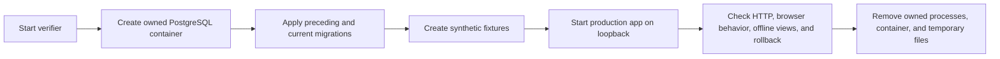

# Test and verify a change

Use the locked Node/npm setup in the [README](../README.md#run-locally). Copy the
example configuration privately and generate Prisma types before checks. Keep
background jobs and public case reads disabled for ordinary local checks.

## Choose a focused check

| Change area                               | Command                                                                                                                                                                                 |
| ----------------------------------------- | --------------------------------------------------------------------------------------------------------------------------------------------------------------------------------------- |
| Case validation and public boundaries     | `npm test -- src/lib/case-review.test.ts src/test/case-review-public-boundaries.test.ts`                                                                                                |
| Reviewed chat reader, API, and rendering  | `npm test -- src/services/reviewed-chat.service.test.ts src/app/api/chatbot/records/route.test.ts src/test/reviewed-chat-answer.test.ts`                                                |
| Senate reader, route, and rendering       | `npm test -- src/services/senate-chat.service.test.ts src/app/api/chatbot/records/route.senate.test.ts src/test/senate-chat-answer.test.ts src/test/reviewed-record-comparison.test.ts` |
| Directory name lookup                     | `npm test -- src/services/politician-name-lookup.test.ts`                                                                                                                               |
| Guest comparison and saved-profile states | `npm test -- src/test/comparison-entry.test.ts src/test/profile-data-states.test.ts`                                                                                                    |
| Private contact                           | `npm test -- src/app/api/contact/route.test.ts`                                                                                                                                         |
| Database client settings                  | `npm test -- src/lib/prisma-client.test.ts`                                                                                                                                             |
| Retained repair behavior                  | `npm test -- src/test/reviewed-controversies.test.ts`                                                                                                                                   |

A focused run helps while iterating. It does not replace the full checks below.

## Run the full local checks

```sh
npm run check
npm run format:check
npm run docs:check
npm run build
```

| Check          | What it establishes                                                             |
| -------------- | ------------------------------------------------------------------------------- |
| `check`        | ESLint with zero allowed warnings, TypeScript checks, and the full Vitest suite |
| `format:check` | Source formatting under the existing Prettier configuration                     |
| `docs:check`   | Formatting for the configured documentation files                               |
| `build`        | Production compilation; a valid `DATABASE_URL` is still required                |

The Vitest setup replaces database and Redis boundaries. Passing unit tests does
not establish real database behavior, a working mailbox, or a ready deployment.
The separate integration check covers the database and browser paths below.

## Verify a prepared release artifact

Use a reviewed source archive prepared for publication. Extract it into a new
empty directory, then enter the extracted project root. The export must omit Git
history, private environment files, installed dependencies, and build outputs.
Install the locked dependencies without copying your development `.env`:

```sh
npm ci
node scripts/verify-source-only.mjs --populated-release
```

The verifier checks pinned test bytes, the exact approved dependency revision,
script inventory, and isolated fixture execution. It rejects `.git` metadata and
private `.env` files in a publication copy. A refusal means the export needs
review; keep those protections intact.

Check the archived file hashes as well. On macOS:

```sh
shasum -a 256 -c publication/source-files.sha256
```

On Linux, use `sha256sum -c publication/source-files.sha256`. Every listed file
must pass. Regenerating a checksum or test inventory does not approve a change.
Review the changed bytes before preparing a new release record.

CI checks its own Git checkout with `--allow-git-checkout` and passes settings
through environment variables. That flag permits only the checkout metadata;
private environment files remain forbidden. Use the contributor checks above in
your configured development checkout, and this procedure for a clean release copy.

## Verify against a disposable database

After generation, ordinary checks, and a production build:

```sh
npx --no-install tsx scripts/verify-case-review.ts
```

Docker and the Puppeteer browser must be available. If the browser is missing,
install the version selected by the locked Puppeteer package with
`npx --no-install puppeteer browsers install chrome`. This downloads a browser;
it does not change package versions.



The verifier accepts no caller-provided database URL. It checks constraints,
retained legacy values, approval transactions, changed fingerprints, public
responses, reviewed-chat citations and cancellation, mobile navigation, offline
invalidation, quota retries, and default-off behavior on the preceding schema.
It does not use the synthetic regression fixtures as live database data.

## Documentation changes

Run the configured check and the two preparation documents outside its glob:

```sh
npm run docs:check
npx --no-install prettier --check PUBLICATION.md scripts/regression/README.md
```

Check every relative file link and heading anchor. Compare documented commands with `package.json` and route examples
with their handlers. Review each Mermaid diagram against the code it describes.
Mermaid rendering requires a viewer that supports fenced Mermaid blocks.

Documentation-only edits do not require a new application build unless they also
change executable configuration, examples used by tooling, or runtime behavior.
Record skipped code checks and the reason rather than implying they ran.

## CI and release evidence

[CI](../.github/workflows/ci.yml) installs npm 11.21.2 and locked dependencies,
checks the source-only boundaries, generates Prisma, and runs lint, typecheck,
tests, build, and the disposable verifier. Its `--allow-git-checkout` option permits
CI's own checkout; it does not approve the original Git history for publication.
Run formatting checks locally as well; the current workflow has no separate
source/documentation formatting steps.

The [verification record](OPEN_SOURCE.md) distinguishes completed local checks
from unverified hosted CI. [Release status](RELEASE_REVIEW.md) tracks the remaining
decisions. Never edit the test-hash inventory to conceal a failing test.

## Verify the populated data path

Run `npm run data:verify` with Docker available. The command creates its own PostgreSQL container in memory, applies migrations, checks import and exact repeat, and proves refusal of changed rows, sibling schemas, and nonempty targets. A deliberately invalid late write must roll back the whole transaction. The owned container is removed even after failure; an existing DATABASE_URL is not used.

Before publishing the reviewed batch, follow the
[release-artifact procedure](#verify-a-prepared-release-artifact). That check
retains the original test hashes and dependency assertions, with the exact
approved Effect override and replacement lock. Keep every existing test and
behavioral assertion when changing the import path.
