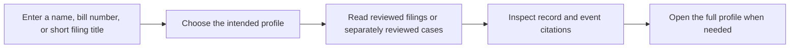

# Use a local installation

Follow the [setup instructions](../README.md#run-locally) first. A fresh database
is empty until you explicitly import the bundled reviewed Senate batch. See the
[data setup](DATA.md#load-the-reviewed-senate-batch) for the dry run and import.

## Browse and compare

1. Choose English, Filipino, or Taglish on the first visit. Change the selection
   later from the header. Some sections still use English.
2. Open **Browse** and look up a person or filter by office and area. If full-text
   search is unavailable, the directory explains its narrower name-search scope.
3. Open a profile and inspect the dates, record coverage, and source links.
4. Use **Compare** to put stored profiles side by side. Missing inputs appear as
   N/A rather than an invented performance rate.
5. Use **Saved** to return to profiles. Guest saved IDs stay in this browser;
   signed-in saved items use the account's records.

A profile may contain positions, affiliations, bills, votes, attendance, finances,
projects, promises, and case/context research when those records are available.
The installation is not a complete candidate list or an official ballot.

## Read a record and its sources

| You see                         | What to do                                                               |
| ------------------------------- | ------------------------------------------------------------------------ |
| A source link                   | Open the exact document and check the supporting passage and date        |
| A case outcome and later relief | Read both; a later pardon or other relief is a separate event            |
| A context record                | Read its subject role; it is not automatically a case against the person |
| A year or month without a day   | Keep that date precision when interpreting the timeline                  |
| No reviewed records             | Treat coverage as unknown; do not infer that no case exists              |
| Withheld research               | Public case reads are disabled while research awaits the required review |
| Temporarily unavailable         | Retry later; the service could not check the research state              |

A citation, source type, or confidence score does not guarantee factual support.
To propose a correction, identify the exact wording, person, source, and passage.
The [private contact form](PRIVATE_CONTACT.md) is usable only when the installation
has configured and verified it.

## Find records in chat

The bottom composer opens a panel after submission. The selected profile stays
visible beside the input. Choose another person to change the selection.

Try `SBN 142` for a filing with conflicting source dates, or a name such as
`Zubiri` and choose the intended person. Use **Records to search** to select Senate
filings or cases. Unsupported questions get a coverage explanation.

Chat repeats approved records with citations. It does not generate a new model
summary, decide guilt or innocence, or recommend a vote. Other questions do not
change the selected person or establish a missing fact. Read
[chat scope](CIVIC_WORKSPACE.md#reviewed-records-in-chat) for the limits.

Closing the panel, leaving the page, hiding the tab, or disconnecting clears its
answer. Send again for a fresh check. A cancelled draft remains available.

## Offline and exported views

Offline views show saved biography fields and withhold case details and counts.
Reload a profile after reconnecting to check its current research. The new-profile
download endpoint remains unfinished; existing saved profiles are preserved.

A profile export is printable HTML using current server-side public rules. A saved
export is a snapshot and cannot establish that later sources or reviews remain
unchanged. The [API reference](API.md) describes the export endpoint.

## Accounts and hosting

Identity verification and admin controls remain prototypes with production
restrictions. Read the [security policy](../SECURITY.md) and
[release status](RELEASE_REVIEW.md) before hosting or supplying personal data.

## Starting from the homepage

Type part of a name in each comparison field, choose the matching profile, then
select **Compare records**. Typing without choosing does not select a person.
Arrow keys and Enter select a suggestion; Escape closes the list.

The comparison leads with the reviewed filing titles, dates, and sources. Other
metrics remain in a separate section when their inputs are unverified.

Choose two distinct profiles in the comparison form, then select **Compare records**. Neither person is preselected. You can change the selection on the comparison page. A selected filing count describes this reviewed sample; it does not measure a politician's full career or performance.

The homepage filing examples follow bill-number order, not impact or popularity.
The profile list is alphabetical. Data coverage means which people, types of
records, and dates the release has checked.

The filing examples open the profile's selected-filings section. Each example also links to its source document. Read the profile's evidence notes when sources use different dates or labels.

Feedback and private contact are grouped in the footer. In short windows, including high-zoom layouts, the closed chat composer follows the page content so it does not cover those controls. The private contact form still needs a configured and verified delivery service.
