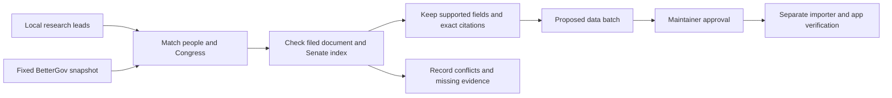

# Senate profiles and selected filings

This proposed batch contains 24 real politician profiles and 45 selected Senate filings. It is a starting dataset for Bakit Kita Iboboto, prepared on November 18, 2026. It has not been approved for import or publication.

The profiles cover the senators named in the Senate's [opening roster on July 28, 2025](https://legacy.senate.gov.ph/photo_release/2025/0728_13.asp). That date matters. The batch does not certify who holds an office today.

## What is included

| Record           | Coverage                                                     | Limits                                                        |
| ---------------- | ------------------------------------------------------------ | ------------------------------------------------------------- |
| Profiles         | 24 publicly used names and dated Senate memberships          | No inferred legal names or current-office badges              |
| Selected filings | 45 bill numbers, titles, summaries, and original introducers | A sample of proposals, not career totals or enacted laws      |
| Filing dates     | 44 dates from Senate filing records                          | SBN-142's date stays unknown because official labels conflict |
| Sources          | 94 source references with field locators and access notes    | Mirrors and derived datasets are not independent confirmation |
| Held filings     | SBN-102, SBN-141, and SBN-179                                | Required comparisons remain incomplete                        |

Every profile has at least one selected filing. The [coverage table](coverage.csv) lists the included and held records for each person. [Review notes](REVIEW_NOTES.md) explain the important differences between sources.

## How the records were checked

The local research files supplied names and matching leads. BetterGov supplied structured people, memberships, and bill candidates. Neither was treated as final evidence for an office, date, or authorship claim.

The bill selection starts with the two lowest-numbered bills carrying one mapped author code for each person in the frozen BetterGov snapshot. The records were then checked against a filed document and a separate Senate legislative index entry. Three candidates were held. The selection is reproducible, but it is not a ranking or a complete account of anyone's work.

A Senate PDF and a Senate index are different records from one institution. BetterGov derives from those records. A search engine or PDF mirror is a way to retrieve evidence, not another independent publisher. The source list records these relationships.

Some old Senate links return errors to automated requests. Where indexed official text supplied evidence, the record says so. It does not claim that a PDF was downloaded or visually inspected. SBN-228 uses a copy hosted at chizescudero.com, checked against the Senate index; byte equality with the Senate-hosted copy has not been established.

## Read the files

| File                                 | Contents                                                                         |
| ------------------------------------ | -------------------------------------------------------------------------------- |
| [data.json](data.json)               | Proposed profiles, filings, missing fields, and claim-to-source links            |
| [sources.json](sources.json)         | Exact document URLs, field locators, retrieval methods, and source relationships |
| [coverage.csv](coverage.csv)         | One row per profile, with included and held filings                              |
| [REVIEW_NOTES.md](REVIEW_NOTES.md)   | Source conflicts, omissions, and correction rules                                |
| [DATA_LICENSE.md](DATA_LICENSE.md)   | Proposed reuse terms and source-document boundaries                              |
| [UPSTREAM_CC0.txt](UPSTREAM_CC0.txt) | BetterGov's unchanged license text                                               |
| [SHA256SUMS](SHA256SUMS)             | Checksums for the other files in this batch                                      |

The BetterGov source is fixed at [commit 6e853ee](https://github.com/bettergovph/open-congress-data/tree/6e853ee027790427c5b5961c6318ff907cf717d5). Its [accuracy notice](https://github.com/bettergovph/open-congress-data/blob/6e853ee027790427c5b5961c6318ff907cf717d5/README.md#data-accuracy-note) warns that manually encoded records can contain errors.

## What is missing

Cases, family relationships, dynasty classifications, election results, party affiliations, financial disclosures, voting records, and attendance are not established by this batch. Missing data means unknown here. It must not appear as zero, a clean record, or proof that no relationship exists.

Current legislative status and enactment are also unknown. A filing shows that a proposal was introduced. It does not show that the proposal passed or produced a promised result.

## Add or correct a record

Provide the exact person, Congress, document number, and field you want to change. Link to the original record and identify the relevant page, section, or dated entry. Add a separate corroborating record where available, and explain whether it is independent or derived from the same source.

Keep conflicting observations in the review record. Do not replace an unknown date with an upload date, give an original filer exclusive credit, or infer kinship from a surname. A data addition still needs maintainer approval before import or publication.
