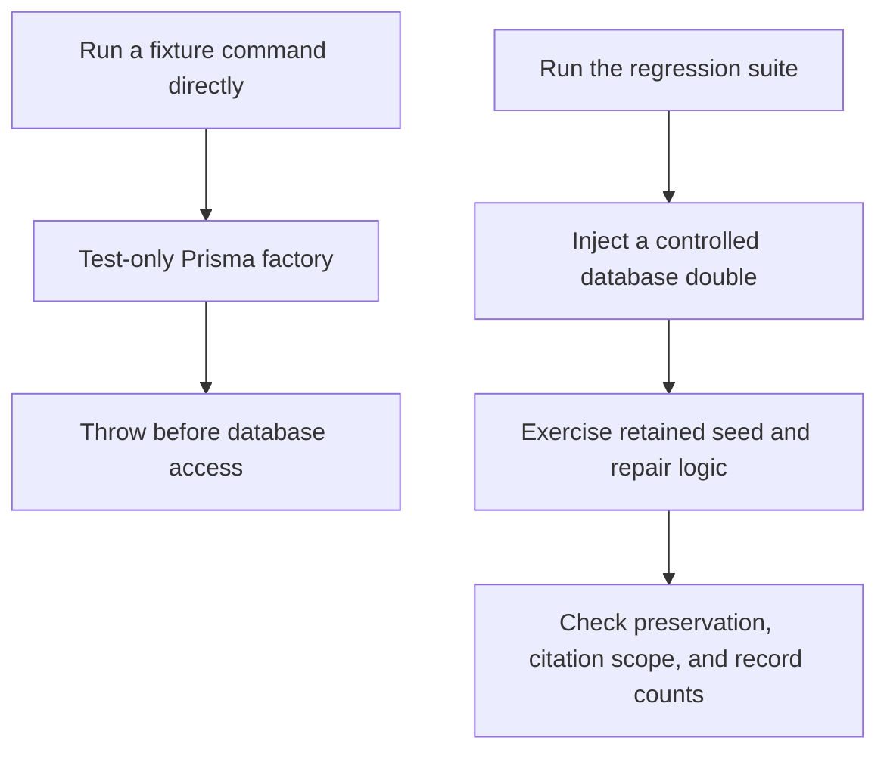

# Regression fixture boundary

Four invented case definitions and placeholder citations support the repair
regression suite. They are not application data. Read the
[synthetic fixture guide](../../docs/FIXTURE_REUSE.md) for their scope.

## Execution boundary



The compatibility modules import `createPrismaClient` from this directory. It
always throws under normal execution, including when a database URL is present.
No flag enables it. The test harness replaces that import with its database double.
Application code does not import these fixtures.

All case inputs and unrelated bulk rows are synthetic. The suite preserves its
40 assertion calls across 14 tests. Original hashes and each approved fixture or
formatting revision remain in
[`publication/original-tests.json`](../../publication/original-tests.json).
The source-only verifier checks the exact permitted bytes and retained logic.
The legacy command filenames remain for compatibility with those checks.

## Run the checks

```sh
npm test -- src/test/reviewed-controversies.test.ts
node scripts/verify-source-only.mjs
```

Keep the existing assertions. These modules are not a database seed, migration,
transfer, or production repair path. Use the [script catalog](../README.md) and
[data guide](../../docs/DATA.md) for tools that can affect a development installation.
